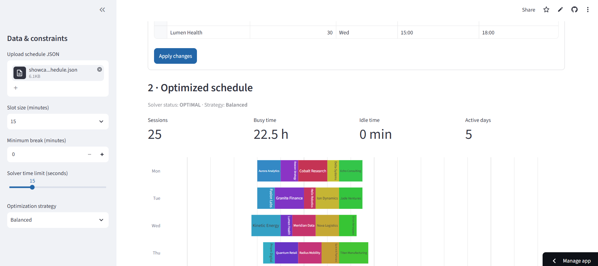

# Smart Schedule Optimizer

[](https://github.com/Triar1/smart-schedule-optimizer/actions/workflows/tests.yml)
[](https://smart-schedule-optimizer-triar1.streamlit.app/)


**Optimize weekly session schedules with constraint programming.** This Python application uses Google OR-Tools CP-SAT to assign sessions to availability windows, enforce minimum breaks, and balance idle time against the number of working days. A Streamlit dashboard makes the optimization accessible without writing code.

**[Try the live application](https://smart-schedule-optimizer-triar1.streamlit.app/)** · [Source code](https://github.com/Triar1/smart-schedule-optimizer)

## Preview

<!-- Capture the actual running app and save it as assets/dashboard.png before the final release. -->


## Features

- **Constraint-based scheduling:** assign every session exactly once, within its availability windows, with no overlaps on a shared resource.
- **Flexible scheduling rules:** configurable time grid, session duration and minimum breaks.
- **Multi-objective optimization:** minimize idle minutes and/or the number of active days using configurable integer weights.
- **Interactive dashboard:** edit sessions and availability windows, explore weekly calendars, and compare strategies.
- **Import/export:** upload JSON inputs, download edited JSON and export optimized schedules as CSV.
- **Reproducibility:** sample dataset, CLI, automated pytest suite and GitHub Actions CI.

## Quick start

Requires Python 3.10+.

```bash
python -m venv .venv
# Windows PowerShell: .\.venv\Scripts\python.exe -m pip install -e ".[dev]"
# macOS / Linux: .venv/bin/python -m pip install -e '.[dev]'
```

Launch the dashboard (Windows PowerShell):

```powershell
.\.venv\Scripts\python.exe -m streamlit run src/scheduler/dashboard.py
```

Or run the command-line optimizer:

```powershell
.\.venv\Scripts\smart-schedule.exe examples/sample.json --min-break 15 --idle-weight 1 --day-weight 60
```

Run the tests:

```powershell
.\.venv\Scripts\python.exe -m pytest -v
```

## Input data

Input is a JSON object containing sessions with unique names, durations in minutes, and availability windows (`day`, `start`, `end`). See [`examples/sample.json`](examples/sample.json). Repeated rows in the dashboard can represent multiple availability windows for the same session.

Use **fictional or anonymized data** when testing the public application; do not upload confidential schedules or personal student information.

## Optimization model

Let `x[s,t]` be a binary decision variable indicating whether session `s` starts at feasible grid time `t`.

- **Assignment:** each session must start exactly once.
- **Capacity:** sessions cannot overlap on the single shared resource.
- **Availability:** starts and durations must fit within allowed windows.
- **Minimum break:** selected sessions must be separated by the configured break.

The objective is:

```text
minimize idle_weight * total_idle_minutes + day_weight * active_days
```

`total_idle_minutes` is the sum of gaps between the first start and last end of each active day, excluding scheduled session durations. It includes required breaks. The weights are user-configurable, and comparisons between different weight settings should use the underlying metrics rather than raw objective scores.

**Solver statuses:** `OPTIMAL` certifies optimality for the configured objective; `FEASIBLE` indicates a valid schedule without proof of optimality within the time limit; `INFEASIBLE` indicates no valid assignment exists under the constraints.

## Limitations

- One shared resource (e.g., one tutor), not multi-tutor scheduling.
- Discrete time grid: session durations must align with the selected slot size.
- Fixed weekly horizon; no recurring calendar synchronization or travel-time constraints.
- Very large scheduling instances may require additional modeling and performance work.

## Project structure

```text
src/scheduler/      Optimization engine, models, CLI, dashboard and helpers
tests/              Automated regression tests
examples/           Sample scheduling data
.github/workflows/  GitHub Actions CI
assets/             Dashboard screenshot
```

## Deployment

Hosted on [Streamlit Community Cloud](https://smart-schedule-optimizer-triar1.streamlit.app/) using `src/scheduler/dashboard.py` as the entry point. The dependencies are installed from `requirements.txt`.

## License

MIT — see [LICENSE](LICENSE).
